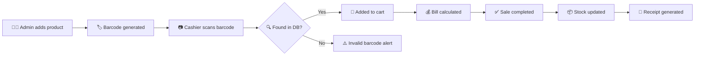
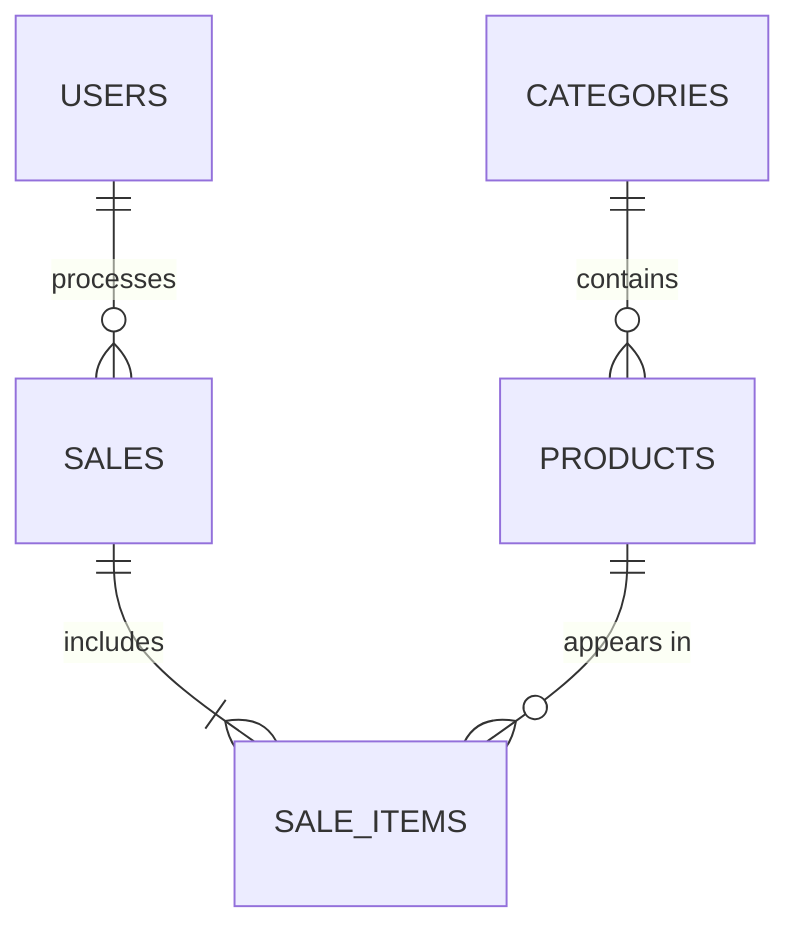

# BarcodeReader
<div align="center">

# 🛒 Barcode-Based POS System

### *Scan. Bill. Done.*

**A desktop Point of Sale app that turns barcodes into instant checkout, smart inventory and clean receipts.**

<br>


[About](#-about) •
[Features](#-features) •
[How It Works](#-how-it-works) •
[Architecture](#-architecture) •
[Database](#-database-design) •
[Setup](#-getting-started) •
[Roadmap](#-roadmap) •
[Team](#-team)

</div>

---

## 🎯 About

The **Barcode-Based POS System** is a 3rd-semester Software Engineering project at **FAST NUCES, Lahore**.

Traditional checkout means typing prices by hand, guessing stock levels and writing bills on paper. This app replaces all of that with barcodes:

> 🏷️ **Admins** register products and generate unique barcodes.
> 📷 **Cashiers** scan an item and it lands in the cart instantly.
> 🧾 **The system** totals the bill, updates stock and prints the receipt.

Faster transactions, fewer mistakes, and inventory that always stays accurate.

---

## ✨ Features

<table>
<tr>
<td width="50%" valign="top">

### 📦 Product Management
- Add, update and delete products
- Search and view product details
- Unique barcode assigned to every product

### 🏷️ Barcode Generation
- Auto-generate barcodes from a number
- Live preview of the barcode
- Save and print barcode labels

### 📷 Barcode Scanning
- Read barcodes with a compatible scanner
- Instant product lookup from the database
- Graceful handling of invalid or unregistered barcodes

### 🛍️ Point of Sale
- Scanned items go straight into the cart
- Change quantities or remove items
- Live subtotal and total calculation

</td>
<td width="50%" valign="top">

### 🧾 Billing & Receipts
- Itemized receipts with names, quantities and prices
- Final amount calculated automatically
- Every transaction saved as a record

### 📊 Inventory Management
- Real-time stock tracking
- Stock auto-updates after each sale
- Blocks sales that exceed available stock
- Low-stock monitoring

### 👤 User Management
- Two roles: **Administrator** and **Cashier**
- Secure login
- Role-based access to features

### 📈 Sales Reports
- Full sales history
- Daily and monthly sales views
- Per-product sales analysis

</td>
</tr>
</table>

---

## 🔄 How It Works



<details>
<summary><b>📖 Step-by-step breakdown</b></summary>

<br>

| Step | What happens |
|:---:|---|
| 1️⃣ | **Product Registration**: the admin adds product information |
| 2️⃣ | **Barcode Generation**: a unique barcode is created for the product |
| 3️⃣ | **Barcode Scanning**: the cashier scans the item |
| 4️⃣ | **Product Identification**: the database is searched using the scanned code |
| 5️⃣ | **Shopping Cart**: the matched product is added automatically |
| 6️⃣ | **Billing**: totals are computed from prices and quantities |
| 7️⃣ | **Transaction**: the cashier completes the sale |
| 8️⃣ | **Inventory Update**: available stock is reduced automatically |
| 9️⃣ | **Receipt**: an itemized receipt is generated |

</details>

---

## 🏗️ Architecture

The app uses a **layered architecture** so the UI, business logic and data never get tangled together.

```text
┌─────────────────────────────────────────────┐
│              🖥️  PRESENTATION LAYER          │
│   Login · Dashboard · Products · POS ·      │
│   Reports · Receipts                        │
└──────────────────────┬──────────────────────┘
                       │
                       ▼
┌─────────────────────────────────────────────┐
│              ⚙️  BUSINESS LOGIC LAYER        │
│   Barcode Processing · Product Lookup ·     │
│   Billing · Inventory · Sales Processing    │
└──────────────────────┬──────────────────────┘
                       │
                       ▼
┌─────────────────────────────────────────────┐
│              🗄️  DATA LAYER                  │
│   Products · Users · Sales ·                │
│   Sale Items · Categories                   │
└─────────────────────────────────────────────┘
```

---

## 🗄️ Database Design



| Table | Purpose |
|---|---|
| 📦 **Products** | Product details and barcode values |
| 👤 **Users** | Administrator and cashier accounts |
| 🗂️ **Categories** | Product categories |
| 💳 **Sales** | Completed sales transactions |
| 🧺 **Sale_Items** | Individual products inside each sale |

---

## 🛠️ Tech Stack

| | Technology | Role |
|:---:|---|---|
| 💻 | **C++** | Core language |
| 🎨 | **Qt Framework** | Desktop GUI |
| 🗃️ | **SQLite / MySQL** | Database |
| 🏷️ | **Barcode library** | Barcode image generation |
| 📷 | **Barcode scanner** | Reading product barcodes |
| 🧰 | **Visual Studio** | IDE |
| 🔀 | **Git & GitHub** | Version control and teamwork |

> 📝 *The final stack will be confirmed as project requirements are finalized.*

---

## 🚀 Getting Started

### Prerequisites

- 🪟 Windows
- C++ compiler
- Visual Studio
- Qt Framework and Qt Creator
- SQLite or MySQL
- Barcode scanner *(optional, only needed for physical scanning)*

### Installation

```bash
# 1. Clone the repository
git clone YOUR_REPOSITORY_URL

# 2. Move into the project
cd Barcode-Based-POS-System
```

Then:

1. Open the project in your IDE.
2. Configure the Qt and C++ dependencies.
3. Set up the database connection.
4. Build the project.
5. Run the application. 🎉

> 🔧 *Detailed setup instructions will be added as development progresses.*

---

## 📁 Project Structure

```text
Barcode-Based-POS-System/
│
├── 📂 src/
│   ├── main.cpp
│   ├── authentication/
│   ├── products/
│   ├── barcode/
│   ├── pos/
│   ├── inventory/
│   ├── billing/
│   ├── reports/
│   └── database/
│
├── 📂 include/
├── 📂 ui/
├── 📂 resources/
│   ├── images/
│   ├── icons/
│   └── styles/
├── 📂 database/
├── 📂 docs/
├── 📂 tests/
└── 📄 README.md
```

> The structure may evolve as implementation progresses.

---

## 🧪 Testing

<details>
<summary><b>Click to see the planned test scenarios</b></summary>

<br>

- ✅ Valid barcode scanning
- ❌ Invalid barcode handling
- 🚫 Duplicate barcode prevention
- 🔍 Product search and identification
- 🔁 Multiple scans of the same product
- 🧮 Shopping cart calculations
- 📉 Insufficient stock handling
- 💳 Successful transaction processing
- 📦 Inventory updates
- 🧾 Receipt generation
- 🗄️ Database consistency

</details>

---

## 🗺️ Roadmap

The project is delivered in increments.

- [ ] **Increment 1:** Core foundation *(add your scope here)*
- [ ] **Increment 2:** *(add your scope here)*
- [ ] **Increment 3:** *(add your scope here)*
- [ ] **Increment 4:** *(add your scope here)*

### 🔮 Future Ideas

| | Idea |
|:---:|---|
| 📱 | QR code generation and scanning |
| 🧑‍🤝‍🧑 | Customer management |
| 🏷️ | Discounts and tax calculation |
| 💳 | Multiple payment methods |
| 🎨 | Custom barcode label designs |
| 📊 | Advanced sales analytics |
| ☁️ | Cloud database sync |
| 🏬 | Multi-store and branch support |

---

## 👥 Team

| Member | Role | GitHub |
|---|---|---|
| Member 1 | *Role* | [@username](https://github.com/username) |
| Member 2 | *Role* | [@username](https://github.com/username) |
| Member 3 | *Role* | [@username](https://github.com/username) |
| Member 4 | *Role* | [@username](https://github.com/username) |
| Member 5 | *Role* | [@username](https://github.com/username) |

| Detail | Info |
|---|---|
| 🎓 Program | BS Software Engineering, 3rd Semester |
| 🏫 University | FAST NUCES, Lahore |
| 📚 Course | *To be specified* |
| 👨‍🏫 Instructor | *To be specified* |

---

## 🤝 Contributing

This is an academic project, but suggestions and feedback are welcome.

1. 🍴 Fork the repo
2. 🌿 Create a branch: `git checkout -b feature/your-feature`
3. 💾 Commit your changes: `git commit -m "Add your feature"`
4. 🚀 Push: `git push origin feature/your-feature`
5. 🔃 Open a Pull Request

---

## 📜 License

Developed for **educational and academic purposes**.

---

<div align="center">

**Built with C++ and Qt ❤️**

*Making retail transactions smarter, faster and more efficient.*

⭐ Star this repo if you like it!

</div>
